# Rig harness: follow one feature from requirement to PR

**Rig is a software-engineering workflow around Claude Code.** Agents plan,
write tests, implement and review. Automatic checks inspect their work, and a
person approves important decisions.

> **The key idea:** The architect defines the work, QA describes the test
> scenarios, and the builder writes executable tests before implementing each
> behaviour. Hooks trigger checks; sensors report concrete problems for the
> builder to fix.

We will follow one example: **“Let users reset a forgotten password by email.”**
This is an illustrative feature, not an application implemented in this repo.

**How to present this guide:** walk through sections 1–3 in order. Section 4
keeps the additional stages and validation details in expandable reference
sections, so you can open them when someone asks for more depth.

Diagrams use **fixed dark SVG artwork**: charcoal backgrounds, dark containers,
colored boxes and light labels. Their appearance does not depend on Mermaid
preview theme settings. Muted gold = people; indigo = agents; steel blue = workflow;
sage teal = checks; slate = evidence; green = pass; muted rose = failure or a blocking condition.

---

## 1. Who does what?

Think of these as **roles taking turns**, not a collection of agents constantly
watching one another. This diagram shows the sprint path; a small task can start
directly with `/rig:start`.


| Component | Is it an AI agent? | In our password-reset example |
|---|---|---|
| **Architect** | Yes: dedicated `rig:architect` | Splits password reset into small intents and observable behaviours. |
| **QA** | Yes: a general-purpose agent acting as QA | Describes valid, expired and reused-token cases; creates synthetic data. |
| **Evaluator** | Yes: dedicated `rig:evaluator` | Reviews the sprint bundle for missing cases, contradictions and weakened requirements. |
| **Builder** | Yes: primarily the main Claude Code session | Writes executable tests and implements the reset feature, one behaviour at a time. |
| **Reviewers** | Yes: fresh-context / native review roles | Review the code and security, including the changed token-validation logic. |
| **Skill** | No: a playbook | `/rig:testplan` tells QA what to produce; `/rig:build` tells the builder how to work. |
| **Hook** | No: an event trigger | Notices that the builder edited a file or finished a turn. |
| **Script / sensor / linter** | No: programs and configured checks | Detects a skipped test, runs ESLint, type-checks or executes the test suite. |

Rig has **two dedicated agent definitions**, architect and evaluator. QA,
building and change review use other roles at the appropriate stages.

**Where the skills fit:** `/rig:init` prepares the repo; `/rig:chart` and
`/rig:testplan` prepare a sprint; `/rig:start`, `/rig:plan`, `/rig:build`,
`/rig:test` and `/rig:pr` carry one change through delivery. Supporting skills
include wiki, learn, rule, arch, app, autonomy and upgrade. Skills guide agents;
the scripts and CI enforce the conditions they can check.

---

## 2. Walk the example: requirement → intents → behaviours → tests

**Person's request:** “Users should be able to reset a forgotten password by
email.” Before proceeding, the person resolves important details such as token
lifetime, allowed password rules and expected errors. For this walkthrough,
assume the valid / expired / single-use outcomes below have been agreed.


Follow the highlighted path: **I2 → B2 → two test cases → one executable test
script → RED → implementation → GREEN**. The other intents and behaviours remain
visible as separate branches.

### Step 1 — Turn the request into small intents

An **intent** is one implementable piece of work, with its purpose, files and
dependencies. The architect might propose:

| Intent | Work to deliver |
|---|---|
| **I1: Issue a reset token** | Create and store a one-time token with an expiry. |
| **I2: Validate token and change password** | Accept valid tokens; reject expired or previously used tokens. |
| **I3: Email and reset screen** | Send the reset link and provide the user-facing flow. |

I1 / I2 / I3 are explanatory labels. Real intents have slugs, requirement links
and dependencies; each charted intent is sized at no more than two engineer-days.

### Step 2 — Describe what I2 must do, before describing its implementation

A **behaviour** is an observable outcome, not a class or function to build.

| Behaviour | What must be observable? |
|---|---|
| **B1: Valid token** | The password changes successfully. |
| **B2: Expired token** | Reset is rejected and the password stays unchanged. |
| **B3: Used token** | Reuse is rejected and the password stays unchanged. |

These outcomes become the change's `spec.md`. The plan maps them to files,
interfaces, tests and verification commands. The person approves that plan before
normal implementation begins.

### Step 3 — QA describes cases; the builder writes executable tests

| Artifact | Who produces it? | B2 example |
|---|---|---|
| **Test plan** | QA | Cover token validity, expiry and reuse. |
| **Test case** | QA | Given an expired token, attempt reset; expect rejection and unchanged password. |
| **Test data** | QA | Synthetic user and expired-token fixture. |
| **Executable test** | Builder | Code that calls reset and asserts both rejection and unchanged password. |

QA's case is a **description**. The builder translates it into **runnable code**
during `/rig:build`. When a sprint case names a data file, the test loads that
file unchanged rather than replacing it with an inline approximation.

### Step 4 — Watch B2 move from RED to GREEN

**First, the builder writes the test.** API names below are illustrative:

```typescript
it('B2 AC-1.2: rejects an expired token without changing the password', async () => {
  const originalHash = await getPasswordHash(userId);

  const result = await resetPassword(expiredToken, 'NewPassword!');

  expect(result.ok).toBe(false);
  expect(await getPasswordHash(userId)).toBe(originalHash);
});
```

1. **RED:** Run the test and capture its failure. Missing expiry validation
   should allow a reset that the test rejects; the builder checks the actual
   failure rather than treating any error as useful proof.
2. **IMPLEMENT:** Add the expiry validation and required failure handling.
3. **GREEN:** Rerun; the request is rejected and the password remains unchanged.
4. **REPEAT:** Do the same for the other behaviours, then run broader verification.

`AC-1.2` represents an acceptance criterion in this example's requirements ledger.
Tests name both the behaviour and relevant acceptance criteria for traceability.

**Important distinction:** cases and data are planned before the build, but rig
does not generate every test script for the entire sprint before any coding.
The normal build loop is **test first, then implementation, per behaviour**.
For a small task, `/rig:start` can define the intent and behaviours without a
full architect → QA → evaluator sprint.

---

## 3. What catches mistakes while the builder codes?

**Sensors are not AI agents.** They are automatic detectors or commands such as
ESLint, the type checker and the test runner. Checks run on events and schedules;
there is no LLM continuously watching every keystroke.


**Read the chain as:** hook = *when to check*; script = *run the applicable
checks*; sensor = *one inspection*; gate = *whether its result blocks or warns*.
The linter is one possible tool behind a command sensor.

### Example: the builder tries to skip the failing B2 test

```typescript
test.skip('B2: rejects expired reset tokens', async () => { /* ... */ });
```

1. The builder edits the test file.
2. Under continuous checking, the post-edit hook invokes the checking script.
3. The `test-tamper` sensor detects the added `test.skip` pattern.
4. Rig reports a blocking finding and tells the builder to fix the failing code
   rather than hide the test. The **builder** makes the fix; the sensor does not.

The edit has already happened: post-edit feedback does not undo it. A later
turn, verification or CI gate checks the work again at its applicable scope.

### Six checks, explained through the same feature

| Sensor | Type | Password-reset example |
|---|---|---|
| **`secrets`** | Built-in pattern check | Detects a recognizable email-provider API key accidentally added to source. It does not detect every possible secret. |
| **`test-tamper`** | Built-in diff check | Detects `test.skip`, deleted tests or a suspicious decrease in assertion count. Weakening detection is heuristic. |
| **`layering`** | Built-in / configured analyzer | Detects an import forbidden by the project's declared architecture rules. |
| **`lint`** | Command, e.g. ESLint | Flags configured lint violations in the changed reset code. |
| **`types`** | Command, e.g. TypeScript | Flags passing a string where the reset function requires a structured token object. |
| **`unit`** | Command, e.g. `npm test` | Detects that the expired-token test or an existing login test now fails. |

The registry, `.rig/sensors.json`, declares commands, cadence, blocking policy
and guidance. Tools must be installed and configured for the project. Fast checks
run after edits; other checks wait for turn end, commit or verification according
to event and model policy. Final verification and CI perform broader checks.

### Two checks connect the implementation back to B2

| Check | What it establishes | What it does not establish |
|---|---|---|
| **Traceability** | A changed test names `B2` and relevant acceptance criteria. | That its assertions faithfully express the requirement. |
| **Red-proof** | For a feature/bugfix, the changed tests fail on base code, while the implementation passes its checks. | That every behaviour has a meaningful assertion, or that failure occurred for the intended reason. |

For example, a test titled “B2: reject expired tokens” could assert the wrong
result. Scripts can check the label and execute the assertion; **reviewers and
the person assess whether the assertion means the right thing**.

### Finish the example

After implementing the behaviours, `/rig:test` runs broader verification and
records `verify.json`. `/rig:pr` performs code and security review, handles fixes,
and requires fresh passing verification. CI independently rechecks the change;
merge follows the configured review and branch-protection policy.

**The story to tell:** architect defines the work → QA describes the scenarios →
person approves → builder writes tests, then code → sensors report mistakes →
builder fixes them → review and CI judge the change before landing.

---

## 4. Additional stages and validation details

These are the existing deeper stages and controls, retained as reference.
Expand one when you want to explain the mechanics behind the example.

<details>
<summary><strong>Repository memory: where the example and its evidence are stored</strong></summary>


Standalone installation also copies scripts into `.rig/bin/` and Claude assets
into `.claude/`. The committed artifacts survive a new chat or a different
engineer. Local state such as `.gate`, `unresolved.json` and the `learn/` scratch
directory is ignored by default.

**This analysis folder is the harness source.** The consumer `.rig/` artifact map above
is what rig creates in a project using it; rig is not enabled on its own source
tree according to this folder's `CLAUDE.md`.

</details>

<details>
<summary><strong>Full lifecycle: sprint planning, approvals and per-change delivery</strong></summary>


**Test plan, test case and test script are distinct:**

| Artifact | Meaning | Produced during |
|---|---|---|
| Test plan | Coverage strategy and test levels | Sprint QA planning |
| Test case | Input, action and exact expected result | Sprint QA planning |
| Test data | Synthetic inputs used by named cases | Sprint QA planning |
| Executable test | Code that exercises the application and asserts the result | Test-first build |

Rig does **not** require every executable test for the entire sprint to exist
before any implementation. Its normal build instructions require a failing test
**before implementing each behaviour**. Small tasks can bypass sprint planning
and start directly with the per-change loop.

</details>

<details>
<summary><strong>Build and verification: test-first loop, base-code proof and refactors</strong></summary>


At verification, rig also reconstructs an independent check:


The base's original test command must first pass, so an already-broken base is
not mistaken for useful red proof. Test support files travel with the changed
tests. This is a suite-outcome check, not proof that each behaviour is correctly
asserted. Missing unit-command/base configuration can also produce warnings
rather than completed proof.

For work captured with `--from-diff`, implementation already exists: tests run
against it, and the base-code check supplies the later red proof.

</details>

<details>
<summary><strong>Check timing: session start, edit, turn end, commit, push and CI</strong></summary>


This is a conceptual progression, not five identical executions. Each event uses
its appropriate diff and schedule. For example, pre-commit inspects staged text,
while command tools run against the working tree; rig warns about unstaged edits.

| Stage | Typical work | Important qualification |
|---|---|---|
| Edit | Pattern checks and file-level lint | Continuous policy runs more checks; secret scanning stays active |
| Turn end | Built-ins and due fast commands | After two blocking attempts, unresolved findings are retained locally rather than looping indefinitely |
| Commit/push | Shared checker through Git hooks | Some timeout failures become warnings; CI must judge the result |
| Verify | Commit/CI command sensors, contracts, traceability, base proof, approved journeys | Writes `verify.json` for the checked tree |
| CI | Recompute checks using base-controlled checker/config; evaluate required human review | Enforcement needs required checks and protected branches |

The default policy is continuous for Haiku/Sonnet and final for Opus. Final
policy keeps the always-on protections while deferring more checks. It is a
configurable scheduling assumption, not proof that one model needs fewer checks.

</details>

<details>
<summary><strong>Sensor configuration: commands, cadence, blocking policy and guidance</strong></summary>

Example from the Node stack's configuration shape:

```json
{
  "id": "lint",
  "cmd": "npx --no-install eslint {files}",
  "cadence": "edit",
  "blocks": true,
  "guide": "Lint must pass on every file you touch; fix the code rather than the rule."
}
```


Built-in sensors use `builtin: true` instead of a command. Sensors can also have
timeouts, options, and numerical ratchets. External tools must be installed and
their commands adapted to the consuming project.

</details>

<details>
<summary><strong>Full sensor catalog: more examples of coding checks</strong></summary>

| Agent's edit / outcome | Checker | What rig can observe | Response |
|---|---|---|---|
| Introduces a lint violation | Lint command sensor | Linter exits nonzero | Block if configured as blocking |
| Passes a string where a number is required | Type-check command sensor | Compiler diagnostic and exit code | Block at its due cadence |
| Adds `test.skip(...)` | Test-tamper built-in | Skip pattern in an added test line | Block |
| Removes more assertions than it adds | Test-tamper built-in | Assertion-count decrease across the diff | Block; heuristic may need human judgment |
| Adds a forbidden framework import in domain code | Layer sensor/analyzer | Declared import boundary violated | Block when configured/enforced |
| Adds `@ts-ignore` with no stated reason | Suppression built-in | Suppression pattern without same-line reason | Block |
| Adds a recognizable credential | Secrets built-in | Secret-pattern match | Block; unusual formats may be missed |
| Omits a test reference to `B2` | Traceability check | Behaviour ID absent from changed test text | Block during verification |
| Tests pass even without the feature | Base-code proof | Changed suite passes on base | Block for feature/bugfix proof |
| Increases a duplication metric | Ratchet command sensor | Number exceeds stored baseline | Block if configured as blocking |

These checks encode standards that can be expressed as rules, metrics, tool
diagnostics or executable assertions. Abstract design quality still requires
review. Pattern checks can have false positives and false negatives.

</details>

<details>
<summary><strong>Failure evidence: captured runs, stale verification and re-approval</strong></summary>


An existing failing command can be recorded as `knownRed` during onboarding.
It then warns until it passes, after which the exemption can be removed.
This is an exemption by sensor ID, not a precise classification of every failure
inside a failing suite. A numerical ratchet is different: it permits improvement
while blocking a metric from getting worse than its baseline.

</details>

<details>
<summary><strong>Limits of the evidence: mechanical checks versus judgment</strong></summary>


| Mechanically checkable | Requires model / human judgment |
|---|---|
| A test names `B2` / an acceptance criterion | The test actually captures the requirement's meaning |
| A command exits successfully | The test suite covers the important failure modes |
| Changed tests fail on base and pass on new code | The failure is caused by the intended missing behaviour |
| A contract file matches its approved hash | The contract itself is correct and complete |
| A declared dependency rule holds | The chosen architecture is appropriate |
| Verification matches the current tree fingerprint | The change is ready for the real operating environment |

**Green checks mean the encoded checks passed.** Rig adds evidence and review
around that result; it does not establish arbitrary natural-language correctness.

</details>

<details>
<summary><strong>Enforcement boundary: local guardrails and protected CI</strong></summary>


Rig is a workflow harness, not a sandbox. Ordinary edit/turn hooks do not
intercept arbitrary Bash commands. A separate managed production hook exists,
but production deployment still needs the deployment system's own controls.
CI's workflow and protection settings must themselves be protected. See
[the security model](SECURITY.md).

</details>

---

## Diagram files

The diagrams are embedded SVGs in `analysis-assets/`; keep that folder beside
this Markdown file. Editable Mermaid source (`.mmd`) is stored alongside each
SVG. The main walkthrough and all expandable reference diagrams use the same
fixed dark palette.

## Source map for this walkthrough

| Topic | Implementation / workflow source |
|---|---|
| Overall design | [DESIGN.md](DESIGN.md), [goal and native-first boundaries](docs/GOAL.md) |
| Sprint decomposition and QA | [chart skill](skills/chart/SKILL.md), [testplan skill](skills/testplan/SKILL.md) |
| Named agents | [architect](agents/architect.md), [evaluator](agents/evaluator.md) |
| Behaviour-to-code sequence | [plan skill](skills/plan/SKILL.md), [build skill](skills/build/SKILL.md), [test skill](skills/test/SKILL.md) |
| Trigger events and turn handling | [hook configuration](hooks/hooks.json), [hook implementation](scripts/hooks.ts) |
| Sensors and schedules | [registry](scripts/registry.ts), [built-ins](scripts/sensors.ts), [Node stack example](templates/stacks/node.json) |
| Verification and base proof | [shared checker](scripts/check.ts), [verify command](scripts/verify.ts), [command evidence](scripts/runs.ts) |
| Approval and PR gates | [lifecycle](scripts/lifecycle.ts), [PR command](scripts/pr.ts), [tree fingerprint](scripts/stamp.ts) |
| CI and trust boundary | [consumer workflow template](templates/rig-check.yml), [SECURITY.md](SECURITY.md) |

*Prepared from source inspection on 2026-10-29. This document does not report a
new test run or a live model evaluation.*
